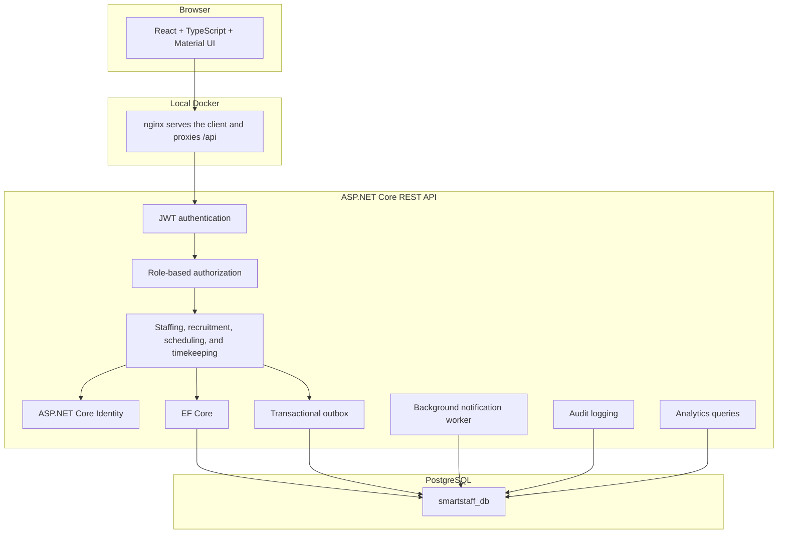

# System architecture

SmartStaff is one React application and one ASP.NET Core API. The API is the only process that opens PostgreSQL. The diagram below is the running local system. AWS is not part of this deployment.

## Request path

The browser calls `/api` on the same origin. Vite proxies that path in development. nginx proxies it in the demonstration image, so the refresh cookie stays on the site origin. Controllers validate input, call an application service, and map the result to an HTTP status. Creates that insert a row return 201.

## Decisions and tradeoffs

**One database for workflow and identity.** Identity, staffing, and the notification outbox commit together through EF Core. A staffing change and its outbox row can share a transaction. The tradeoff is that the API and the worker share one PostgreSQL instance. That is appropriate for a local proof of concept and would need a capacity review before any larger deployment.

**JWT plus a server-side security stamp.** The access token is a signed JWT and includes the Identity security stamp. The API reads the current stamp from PostgreSQL on each request. Logout rotates the stamp, so older tokens fail without a shared in-memory denylist. The tradeoff is a database read on authenticated requests. The token lifetime remains short, and a stolen token still works until expiry or the next stamp change.

**Refresh cookies instead of storing refresh tokens in the browser script.** The refresh token is hashed in PostgreSQL and sent as an HTTP-only cookie. Logout and refresh require a CSRF header. The tradeoff is extra cookie handling in local HTTP, which the demonstration Compose file allows with `COOKIE_SECURE=false`. A hosted HTTPS deployment would set the secure flag.

**Role checks plus facility membership.** A role such as Facility Manager is not enough by itself. Queries also require membership or recruiter assignment for that facility. The tradeoff is more access rules in the services, which is what keeps one clinician from reading another facility.

**Facility-local input, UTC storage.** Shifts and clock times are entered in the facility timezone and stored as UTC offsets. Invalid and ambiguous daylight-saving times are rejected instead of guessed. Timesheet hour fields still accept an offset directly. Historical attendance rows are not rewritten when conversion rules change.

**Transactional outbox and a polling worker.** Workflow code writes an outbox row in the same database transaction as the business change. A hosted service polls that table, writes in-app notifications, and records an email row. Delivery stops after eight attempts. The tradeoff is delay of about the poll interval, which defaults to 15 seconds, and email that does not leave the database. An external provider is not registered.

**Advisory locks for attendance.** Clock-in takes a PostgreSQL transaction advisory lock for the clinician so two overlapping punches cannot both commit. The tradeoff is that the lock is database-specific. It fits this PostgreSQL deployment and would be revisited if the database engine changed.

**Analytics read the operational tables.** There is no separate warehouse. Reports match the rows the workflow just wrote. The tradeoff is that heavier reporting would compete with operational writes. Indexes added for the report queries are the current limit of that work.

## What is intentionally outside the running system

Docker Compose is the demonstration boundary. Terraform files describe a possible future VPC, private API service, managed PostgreSQL, and static frontend. They have not been applied, and this diagram does not show them as deployed components. See `docs/AWS_ARCHITECTURE.md` and `docs/DEPLOYMENT_CHECKLIST.md` for that unused design and its blockers.
